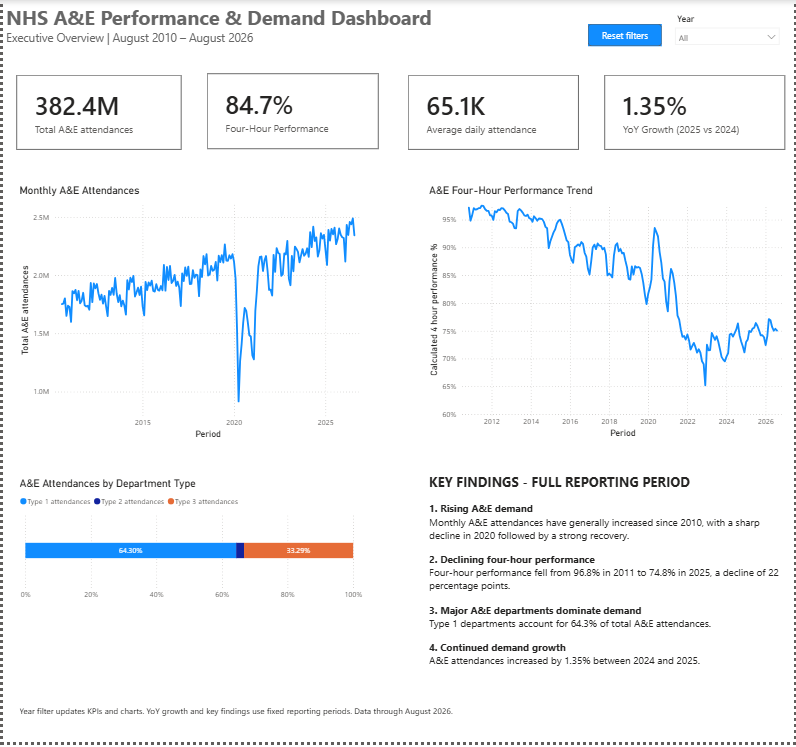
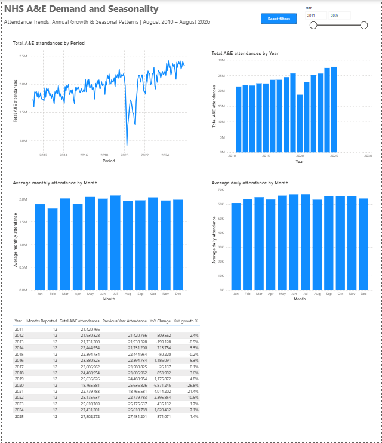
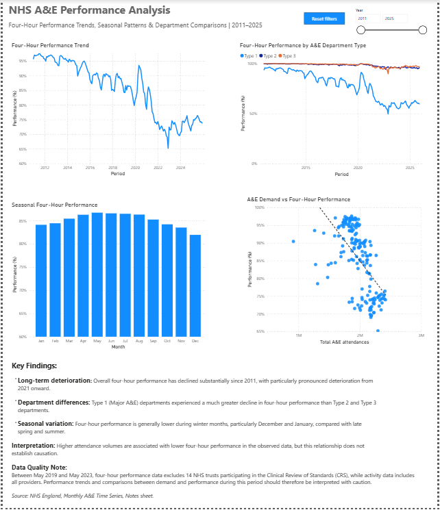
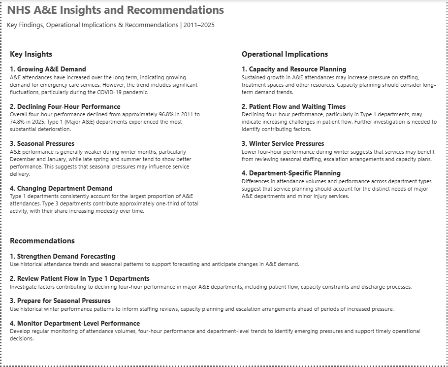

# NHS A&E Performance and Demand Analysis

**Tools:** Power BI Desktop · Power Query · DAX\
**Source:** NHS England, Monthly A&E Time Series\
**Data period:** August 2010--August 2026\
**Annual comparisons:** Complete calendar years, 2011--2025

## Project overview

This project explores trends in Accident and Emergency (A&E) attendances
and four-hour waiting time performance across NHS England.

Using publicly available NHS England data, I developed an interactive
Power BI dashboard to investigate how A&E demand has changed over time,
identify seasonal patterns, compare performance across different A&E
department types, and examine trends in booked appointments.

The project involved cleaning and transforming raw data, building a
relational data model, creating DAX measures, and designing interactive
visualisations. The aim was to turn historical healthcare data into
meaningful insights that could support service planning, performance
monitoring and operational decision-making.



## Business problem and analytical objectives

A&E departments face ongoing challenges in managing patient demand,
maintaining timely access to care, and planning resources effectively.
Understanding historical attendance volumes and waiting time performance
can help organisations identify periods of increased pressure and
support evidence-informed service planning.

The analysis addresses six questions:

1.  How have A&E attendances changed over time?
2.  Are there recurring monthly or seasonal patterns in demand?
3.  How has four-hour performance changed?
4.  How do attendance volumes and performance differ between Type 1,
    Type 2 and Type 3 departments?
5.  What relationship exists between attendance volumes and four-hour
    performance?
6.  How have booked A&E attendances changed since reporting began in
    August 2020?

The intended outcome was an interactive dashboard that supports
exploration of activity and performance trends, highlights potential
operational pressures, and informs further investigation.

## Dataset and preparation

The NHS England Monthly A&E Time Series provides monthly, England-level
historical reporting. The Power BI model uses:

| Table | Purpose |
|---|---|
| `Activity` | Total attendances and attendance volumes by department type |
| `Performance` | Attendances within and beyond four hours, including department breakdowns |
| `Booking` | Booked A&E attendances (reported from August 2020) |
| `DimDate` | Shared reporting period, year, month and month number |

In Power Query, I removed redundant null columns and header rows,
cleaned column names, corrected reporting periods to Date and attendance
counts to Whole Number, and formatted percentage fields. I created
`DimDate` and established relationships to support consistent time-based
filtering across the three reporting tables.

## Data modelling and DAX

The measures cover overall attendance, average daily and monthly demand,
previous-year and year-on-year changes, four-hour performance,
department attendance totals and shares, and booked attendance activity.

**Average daily attendance** divides attendance volume by the number of
calendar days represented by the selected months:

``` dax
Average daily attendance =
DIVIDE(
    [Total A&E attendances],
    SUMX(
        VALUES(DimDate[Period]),
        DAY(EOMONTH(DimDate[Period], 0))
    )
)
```

**Four-hour performance** is calculated from attendance counts, rather
than averaging monthly percentages, so periods with different volumes
receive appropriate weight:

``` dax
Calculated 4 hour performance % =
DIVIDE(
    SUM(Performance[Total Attendances < 4 hours]),
    SUM(Performance[Total Attendances < 4 hours])
        + SUM(Performance[Total Attendances > 4 hours])
)
```

**Validated year-on-year growth** suppresses comparisons against
incomplete early reporting years:

``` dax
validated YoY growth % =
VAR CurrentYear = SELECTEDVALUE(DimDate[Year])
RETURN
    IF(
        ISBLANK(CurrentYear) || CurrentYear < 2012,
        BLANK(),
        [YoY attendance change %]
    )
```

The annual analysis is restricted to 2011--2025 to avoid comparing the
partial years 2010 and 2026 against complete years. Further measure
details are provided in [DAX technical reference](DAX_MEASURES.md).

### KPI validation

The Executive Summary metrics were independently checked:

| KPI | Validated result |
|---|---:|
| Total A&E attendances, Aug 2010–Aug 2026 | 382,411,747 |
| Overall four-hour performance | 84.7% |
| Average daily attendance | 65,091.36 |
| Attendance growth, 2025 versus 2024 | 1.35% |

## Dashboard pages

### 1. Executive Summary

Provides four headline indicators, monthly attendance and four-hour
performance trends, attendance distribution by department type, and
concise key findings. A Year slicer and Reset Filters button support
exploration. The growth KPI specifically compares the complete years
2025 and 2024.


### 2. Demand and Seasonality

Examines monthly attendance trends, annual attendance totals, average
monthly demand by calendar month, average daily demand by calendar
month, and validated year-on-year growth. Using average daily attendance
alongside monthly totals helps account for differing month lengths.
Annual comparisons use complete years.



### 3. Performance Analysis

Explores overall four-hour performance, differences between department
types, seasonal performance patterns, and the observed relationship
between monthly demand and performance. The demand-versus-performance
scatter chart is exploratory: correlation does not establish causation,
and reporting coverage differs for part of the period.



### 4. Department and Booked Appointments

Compares monthly attendances across Type 1, Type 2 and Type 3
departments, their relative attendance shares, booked attendances as a
proportion of total activity, and monthly booked attendance volumes.
Booked appointment reporting begins in August 2020.


### 5. Insights and Recommendations

Summarises the key findings, potential operational implications, and
recommendations for demand forecasting, Type 1 patient-flow
investigation, seasonal preparedness and department-level performance
monitoring.



## Key findings and conclusions

-   **Long-term demand growth:** A&E attendances generally increased
    over the reporting period. Attendances grew **1.35%** from 2024 to
    2025, the two most recent complete years in the dataset.
-   **Declining four-hour performance:** The overall performance trend
    deteriorated substantially from earlier years, particularly in major
    Type 1 departments.
-   **Seasonal variation:** Both attendance volumes and performance vary
    by calendar month; winter performance is generally weaker than in
    late spring and summer.
-   **Department differences:** Type 1 departments account for the
    largest share of A&E attendances and show more pronounced
    performance deterioration than Type 2 and Type 3 departments.
-   **Booked activity:** Recorded booked A&E attendances have increased
    since reporting began in August 2020. This analysis does not
    establish an effect of booked appointments on four-hour performance.

Taken together, the findings suggest that historical demand, seasonal
variation and department-specific performance should be considered when
reviewing emergency care pressures. The dashboard is intended to support
investigation and discussion, not to provide causal explanations or a
forecast of future performance.

## Data limitations and interpretation

-   **Partial years:** The time series begins in August 2010 and ends in
    August 2026. Annual comparisons focus on the complete years
    2011--2025.
-   **Clinical Review of Standards pilot:** Between May 2019 and May
    2023, four-hour performance reporting excluded 14 participating
    trusts, while activity reporting included all providers. Comparisons
    between demand and performance in this period require caution.
-   **Booked appointments:** Booked A&E attendance reporting begins in
    August 2020; missing earlier values do not imply zero booked
    activity.
-   **Type 3 reporting:** Some Type 3 and overall attendance reporting
    was affected by a cyberattack-related shortfall between August 2022
    and February 2023.
-   **Association is not causation:** Observed demand--performance
    relationships cannot establish what caused changes in waiting times.

**Source:** NHS England, *Monthly A&E Time Series*, including its
accompanying reporting notes.\
https://www.england.nhs.uk/statistics/statistical-work-areas/ae-waiting-times-and-activity/

## Project files

-   `images/` - screenshots of the five final dashboard pages.
-   `DAX_MEASURES.md` - selected DAX definitions and documented
    calculation patterns.
-   **Power BI report (`.pbix`):** to be added separately once the final
    report file is ready to share.

------------------------------------------------------------------------

*Independent portfolio analysis of publicly available NHS England data.
Not an official NHS England report.*
